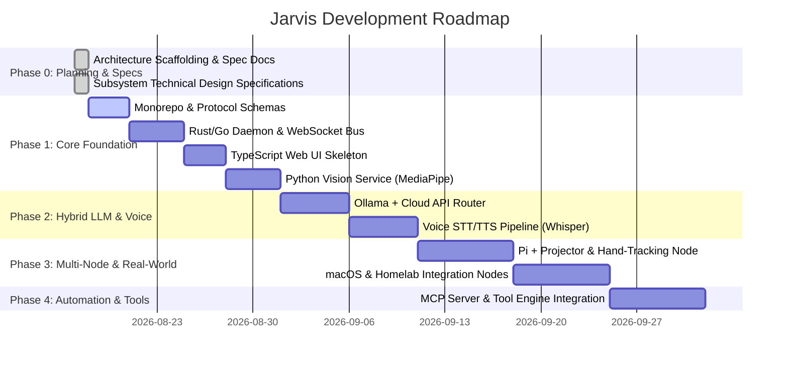

# Jarvis Project Status & Roadmap

> **Current Phase**: Phase 1 — Core Foundation (MacBook Offline Development Mode)  
> **Active Branch**: `main` (feature branch `feat/macbook-offline-core-sim` was merged in, fast-forward, and deleted)  
> **Canonical Plan**: [`docs/superpowers/plans/2026-08-19-mira-custom-voice-agent-os-plan.md`](./docs/superpowers/plans/2026-08-19-mira-custom-voice-agent-os-plan.md) (the 2026-08-17 plan referenced below is superseded)  
> **Just-Completed Plan**: [`docs/superpowers/plans/2026-08-19-mira-protocol-v2-gateway-guardrail-plan.md`](./docs/superpowers/plans/2026-08-19-mira-protocol-v2-gateway-guardrail-plan.md) — Tasks 2-6, done and merged (its `.superpowers/sdd/` workspace ledger was deleted per the finishing-a-development-branch cleanup step; this file and `CHECKPOINT_LAST.md` are the durable record now)  
> **Last Updated**: August 19, 2026  
> **Status**: Tasks 1-6 complete and merged to `main` (commit `89bcefd`). Protocol v2 contracts, Rust daemon (WebSocket gateway + node registry), and guardrail (deny-by-default policy engine + Ed25519 dev signing) are built, wired together end-to-end over a Unix Domain Socket, and passed a whole-branch review (1 fix round + 1 closure fix, both re-reviewed clean). 25/25 Rust tests + 12/12 Python tests + `tsc --noEmit` clean, all re-verified on the merged result. Several Important findings from the whole-branch review were deliberately deferred as follow-up-plan tickets rather than fixed here — see "Deferred From the Gateway/Guardrail Plan" below. Tasks 7-14 (the voice loop: real macOS volume handler, `VoiceStateEvent` protocol contract, identity/memory, Codex dev-route client, the 9-state `VoiceLoop` FSM, real `DaemonClient`, and real Sherpa-ONNX/Silero/faster-whisper/Kokoro hardware adapters) are implemented on `feat/mira-voice-loop`, individually test-verified against real components (real `codex` CLI, a real daemon+guardrail round trip that changed system volume, a real KeywordSpotter construction against the built "mira" model) — full end-to-end mic-to-speaker manual verification (Task 15) is still pending, since it requires a human physically present with the real mic/speaker. Next up: run that manual verification, then Implementation Sequence step 4 (Tauri menu-bar app / projector simulator).

---

## 📌 Executive Summary

This project is a dedicated, custom-built personal Jarvis assistant. It moves away from standard chatbot UIs like OpenWebUI into a fully modular, multi-node ambient intelligence system.

It features:
- A high-performance **Rust/Go Core Daemon** for event routing, device control, and system hooks.
- A modern **TypeScript Web Dashboard & Ambient UI** for visual controls, spatial overlays, and status monitoring.
- A **Python Vision & Perception Microservice** for hand-tracking, webcam feeds, and projector interaction (e.g. Pi + camera setup).
- A **Hybrid Model Router** orchestrating fast local LLMs (Ollama) and high-reasoning cloud LLMs (Claude, OpenAI, Gemini).
- A **Multi-Node Device Network** seamlessly bridging PC, Mobile, Raspberry Pi, and Homelab infrastructure.

---

## 📚 Complete Architectural Specs Index

All subsystem architecture specifications are approved and saved under [`docs/superpowers/specs/`](./docs/superpowers/specs/):

1. 🏛️ **[`2026-08-17-jarvis-architecture-design.md`](./docs/superpowers/specs/2026-08-17-jarvis-architecture-design.md)** — Master Monorepo Architecture & IPC Schemas.
2. 🎙️ **[`2026-08-17-voice-and-audio-pipeline.md`](./docs/superpowers/specs/2026-08-17-voice-and-audio-pipeline.md)** — VAD, OpenWakeWord, faster-whisper STT, Kokoro-TTS, multi-node audio routing.
3. 🌐 **[`2026-08-17-multi-node-networking-and-security.md`](./docs/superpowers/specs/2026-08-17-multi-node-networking-and-security.md)** — mDNS discovery, authenticated pairing, WebSocket RPC, permission tiers (`ADMIN`, `SENSOR_PUBLISHER`).
4. 🖐️ **[`2026-08-17-gesture-vocabulary-and-spatial-projection.md`](./docs/superpowers/specs/2026-08-17-gesture-vocabulary-and-spatial-projection.md)** — MediaPipe 3D tracking, 4-point Homography matrix calibration ($H$), gesture map, visual overlays.
5. 🧠 **[`2026-08-17-hybrid-intelligence-router-and-memory.md`](./docs/superpowers/specs/2026-08-17-hybrid-intelligence-router-and-memory.md)** — Intent classification matrix, 3-tier memory engine (RAM, SQLite, Vector RAG), cloud failover.
6. 🚀 **[`2026-08-17-innovative-features-and-future-expansions.md`](./docs/superpowers/specs/2026-08-17-innovative-features-and-future-expansions.md)** — Proactive engine, context modes, spatial audio chimes, Homelab MQTT, MCP server integration.

---

## 🧭 Project Roadmap

---

## 📊 Component Readiness Grid

| Subsystem | Spec Document | Implementation Status | Notes |
| :--- | :--- | :--- | :--- |
| **Agent Guidelines** | [`AGENTS.md`](./AGENTS.md) | ✅ Ready | Rules & context for AI collaborators |
| **Master Arch Spec** | [`specs/2026-08-17-jarvis-architecture-design.md`](./docs/superpowers/specs/2026-08-17-jarvis-architecture-design.md) | ✅ Ready | Overall monorepo blueprint |
| **Voice Pipeline Spec** | [`specs/2026-08-17-voice-and-audio-pipeline.md`](./docs/superpowers/specs/2026-08-17-voice-and-audio-pipeline.md) | ✅ Ready | VAD + Whisper + Kokoro-TTS |
| **WhisperFlow Voice Spec** | [`specs/2026-08-17-low-latency-speculative-voice-streaming.md`](./docs/superpowers/specs/2026-08-17-low-latency-speculative-voice-streaming.md) | ✅ Ready | Two-pass AI speech sanitizer & <350ms streaming |
| **Networking & Security Spec** | [`specs/2026-08-17-multi-node-networking-and-security.md`](./docs/superpowers/specs/2026-08-17-multi-node-networking-and-security.md) | ✅ Ready | mDNS + mTLS + Auth Scopes |
| **SSH Automation Spec** | [`specs/2026-08-17-macos-command-sandbox-permission-guard.md`](./docs/superpowers/specs/2026-08-17-macos-command-sandbox-permission-guard.md) | ✅ Ready | Multi-node SSH key/sshpass admin control bridge |
| **Gestures & Projection Spec** | [`specs/2026-08-17-gesture-vocabulary-and-spatial-projection.md`](./docs/superpowers/specs/2026-08-17-gesture-vocabulary-and-spatial-projection.md) | ✅ Ready | Homography $H$ + MediaPipe |
| **Auto-Homography Spec** | [`specs/2026-08-17-projector-auto-homography-calibration.md`](./docs/superpowers/specs/2026-08-17-projector-auto-homography-calibration.md) | ✅ Ready | OpenCV ArUco 1.5s flash auto-calibration |
| **Router & Memory Spec** | [`specs/2026-08-17-hybrid-intelligence-router-and-memory.md`](./docs/superpowers/specs/2026-08-17-hybrid-intelligence-router-and-memory.md) | ✅ Ready (Updated) | Nemotron 3.5 Lightning MoE + AI self-evaluating cloud escalation |
| **Circuit-Breaker Spec** | [`specs/2026-08-17-offline-circuit-breaker-fallback-router.md`](./docs/superpowers/specs/2026-08-17-offline-circuit-breaker-fallback-router.md) | ✅ Ready | 3-state circuit breaker & zero-downtime offline cascade |
| **Proactive & MCP Spec** | [`specs/2026-08-17-innovative-features-and-future-expansions.md`](./docs/superpowers/specs/2026-08-17-innovative-features-and-future-expansions.md) | ✅ Ready | Ambient modes & spatial sound |
| **Ambient Presence Spec** | [`specs/2026-08-17-ambient-presence-and-proactive-night-mode.md`](./docs/superpowers/specs/2026-08-17-ambient-presence-and-proactive-night-mode.md) | ✅ Ready | 24/7 webcam wall UI tracking & ESP32 MQTT relays |
| **Multimodal Wand Spec** | [`specs/2026-08-17-handheld-multimodal-controller-wand.md`](./docs/superpowers/specs/2026-08-17-handheld-multimodal-controller-wand.md) | ✅ Ready | Seeed XIAO ESP32-S3 macro wand & tactile desk controller |
| **Web Dashboard Spec** | [`specs/2026-08-17-web-ui-projection-design.md`](./docs/superpowers/specs/2026-08-17-web-ui-projection-design.md) | ✅ Ready | Pi Projector `#000000` canvas, Purple/Orange palette, 3D Wireframe Globe, `Zen Dots`+`Geo` fonts |
| **Shared IPC Schemas** | JSON Schema / Protobuf | ✅ Complete | v1 schemas (`aa8bc51`) + protocol v2 (`MiraEnvelopeV2`, `CapabilityRequest`, `ActionManifest`, `CapabilityReceipt`) across JSON Schema/Pydantic/TypeScript/Rust, fixture-tested |
| **Core Daemon** | Rust | ✅ Complete (Phase 1 scope) | `daemon/` — Axum WebSocket gateway, node registry (`registry.rs`), connection broker (`broker.rs`), loopback-only trust boundary enforced in code |
| **Guardrail** | Rust | ✅ Complete (Phase 1/dev scope) | `guardrail/` — deny-by-default `PolicyTable`, Ed25519 `DevSigner`, UDS IPC server wired to the daemon (dev-dependency only — no compile-time path from the daemon binary); real `mac.volume.set` handler via `osascript` with real rollback evidence |
| **Voice Loop** | [`plans/2026-08-19-mira-voice-loop-plan.md`](./docs/superpowers/plans/2026-08-19-mira-voice-loop-plan.md) | 🔶 Implemented, manual E2E pending | `voice/` — Sherpa-ONNX wake ("mira"), Silero VAD, faster-whisper STT, Kokoro TTS (runs in a dedicated `voice/.venv`, Python 3.12 — kokoro's PyPI releases don't support 3.13), Codex dev-route turn, real macOS volume capability with rollback evidence. 18/18 tests pass; live mic/speaker conversation not yet manually verified |
| **Web Dashboard** | TypeScript (Vite/React) | ⏳ Pending | UI skeleton in `web/` |
| **Vision Service** | Python (MediaPipe/OpenCV) | ⏳ Pending | Vision service in `vision/` |
| **Hardware Simulators** | Python / Node.js / HTML | ⏳ Pending | Virtual GPU, Wand, & Printer nodes in `nodes/simulator/` |

---

## 🎫 Deferred From the Gateway/Guardrail Plan (follow-up-plan tickets)

The whole-branch review of the protocol-v2/gateway/guardrail plan (Tasks 2-6) found these Important findings and explicitly recommended ticketing them for the next (LAN/production-hardening) plan rather than fixing them in Phase 1's dev-scoped build. Not yet actioned — pick these up when that plan is written:

- **`sender_node` / identity spoofing on the broadcast path**: `daemon/src/broker.rs`'s `handle_socket` republishes a client's envelope with whatever `sender_node`/`auth_context` it supplied, unvalidated against the connection's registered identity. Confirmed live today (not just theoretical) — any registered node can currently impersonate `"gateway"` or another node to broadcast subscribers. Needs identity-stamping at publish time and a reserved `"gateway"` node_id that registration refuses.
- **Non-canonical, Rust-only-verifiable receipt signing**: `guardrail/src/signing.rs` signs `serde_json::to_vec` in Rust struct-declaration order, but clients receive the JSON re-serialized in key-sorted order. Only a Rust consumer that deserializes back into the struct first can currently verify a signature. Needs a canonical encoding (e.g. JCS/RFC 8785) before the audit trail or a Python/TypeScript consumer is built on top of this.
- **Rust protocol mirror is looser than its JSON Schema/Pydantic counterparts**: `crates/mira-protocol` has no `#[serde(deny_unknown_fields)]` and never validates `protocol_version` against the schema's `const: 2`, while Python/TS both enforce strictly. Rust is the side that gates capability execution.
- **`CapabilityReceipt` can't distinguish "policy authorized this" from "this actually executed"**: the guardrail currently signs `SUCCESS` with populated `rollback_evidence` for capabilities that have no real device handler yet (correctly scoped for now — no macOS handler exists — but the receipt shape doesn't record the difference). Worth an `AUTHORIZED`/`SUCCESS`/`FAILURE`/`ROLLED_BACK` split plus a requester field before receipts are persisted to an audit trail — cheaper as a protocol v2 change now than a migration later.
- **`guardrail/src/ipc.rs`'s `accept()` errors panic the whole guardrail process** on a transient error (e.g. EMFILE), with no supervision — the daemon keeps running and silently converts every subsequent capability request into an unsigned `FAILURE` receipt.
- **Capability-dispatch `mpsc` channel is unbounded** (`daemon/src/broker.rs`) — no backpressure/rate-limiting on a single connection's capability requests; this regressed from the original Task 6 fix that removed a synchronous await.
- **Signing-key file permissions and path**: `guardrail/src/signing.rs` writes the Ed25519 key with default (world-readable) permissions to a predictable `/tmp/mira-dev/` path. Low risk under the current single-developer-machine scope, but should move to `~/.mira/` with `0600` before the trust model changes.
- **`trace_id` dropped on receipt/error envelopes**: `daemon/src/broker.rs`'s `capability_receipt_envelope` and `error_envelope` both mint a fresh `trace_id` instead of propagating the request's, breaking correlation at the one process boundary where it matters most.
- **MSRV 1.75 claimed but never verified**: no `rust-toolchain.toml`, no CI, only rustc 1.96 available locally; the resolved lockfile likely includes dependencies with a higher MSRV than 1.75.

**Smaller Minor items** (the plan's own SDD ledger was deleted per the finishing-a-development-branch cleanup step — this is the durable record of what it held):
- Nullable-but-required JSON Schema fields vs `Optional` Pydantic fields (`rollback_plan`, `token`, `cert_fingerprint`, `rollback_evidence`, `signature`, `ack_ref`) — copied verbatim from the plan's own brief, no live bug.
- `daemon/Cargo.toml`: `serde` and `futures-util` should be dev-only dependencies, not runtime ones.
- `daemon/src/registry.rs`: `NodeHandle.topics` is dead/unused state — the connection-local `HashSet` in `broker.rs` is the real filter.
- `daemon/src/broker.rs`: no liveness/heartbeat for half-open WebSocket connections; no deadline on the first `recv()` (a connection that never registers hangs forever); `RecvError::Lagged` broadcast errors are swallowed without a `tracing::warn!`; binary WS frames are silently ignored; no RAII guard around `registry.deregister` (a panic/abort permanently leaks that `node_id`, since duplicates are rejected); `handle_socket` has grown large enough to be worth splitting before more capability-dispatch logic lands on it.
- `guardrail/src/ipc.rs`: a malformed request writes nothing back before the caller's timeout, so the caller gets the wrong diagnostic ("did not respond within 5s" instead of a parse error); unbounded `read_line` on both the daemon and guardrail sides of the UDS link (local-peer OOM risk, fails closed); the stale-socket-file `remove_file`-before-bind lets a second guardrail instance silently hijack a socket the first is still serving; the socket's parent directory is only created as an incidental side effect of the signing key's directory happening to be created first.
- `daemon/tests/broker_test.rs`: hardcodes `/tmp/mira-dev-unused.sock`, coupling a test to global filesystem state.
- `guardrail/Cargo.toml`: `tokio` pulls in `features = ["full"]`, broader than this trust-sensitive crate's actual usage needs.
- `daemon/tests/capability_dispatch_test.rs`: a `tokio::time::sleep(50ms)` used to wait for a UDS listener to bind is a potential CI flake source.

---

## 📝 Key Architecture Decisions Log (ADRs)

- **ADR-001: Bespoke Polyglot Architecture vs. OpenWebUI**
  - *Decision*: Build a custom system instead of extending OpenWebUI.
  - *Rationale*: OpenWebUI is optimized for single-session web chat. Jarvis requires multi-node device routing, local daemon system hooks, low-latency background events, and real-time computer vision streams.

- **ADR-002: Polyglot Microservices (Rust/Go + TS + Python)**
  - *Decision*: Core daemon in Rust or Go; Web UI in TypeScript; Vision in Python.
  - *Rationale*: Leverages the best tool for each domain—Rust/Go for system speed & concurrency, TypeScript for rich UI, Python for ML/MediaPipe ecosystem.

- **ADR-003: Hybrid Local/Cloud LLM Router**
  - *Decision*: Use Ollama locally for fast intent extraction & offline control; bridge to Claude/OpenAI APIs for deep reasoning.
  - *Rationale*: Ensures resilience, low latency for simple actions, and high intelligence when required.

- **ADR-004: mDNS Zero-Config Node Discovery**
  - *Decision*: Use mDNS (`_jarvis-core._tcp.local`) for automatic node discovery across local WiFi.
  - *Rationale*: Eliminates hardcoded IP addresses for Raspberry Pi, Mobile, and secondary PC nodes.

- **ADR-005: 4-Point Homography Perspective Calibration Matrix ($H$)**
  - *Decision*: Use OpenCV homography perspective matrix transformation to map webcam pixel space to projector projection surface.
  - *Rationale*: Allows high-accuracy spatial hand-tracking cursor control on any flat projection surface.

---

## 🏁 Action Plan When Returning Home:
1. Open this workspace in your IDE (`/Users/aryavora/desktop/personal projects/jarvis`).
2. Follow **Phase 1** steps in [`specs/2026-08-17-jarvis-architecture-design.md`](./docs/superpowers/specs/2026-08-17-jarvis-architecture-design.md).
3. Initialize `shared/schemas/`, scaffold `daemon/`, `web/`, and `vision/` skeleton modules.
